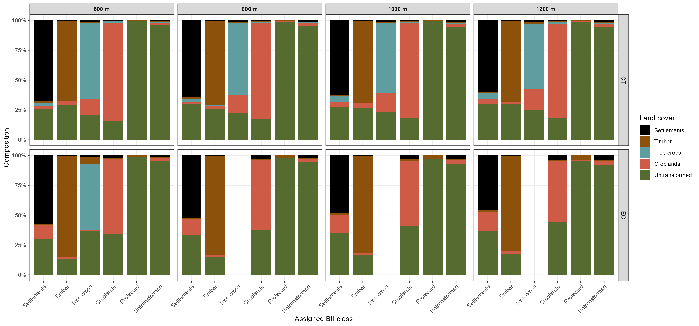
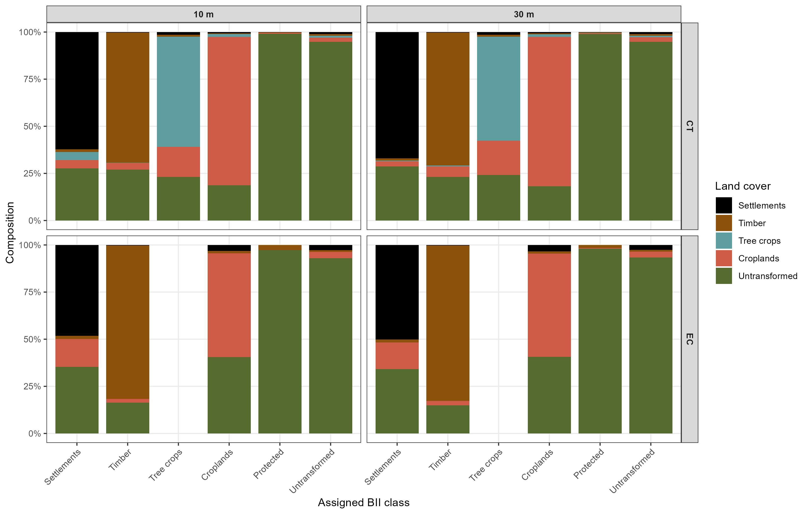
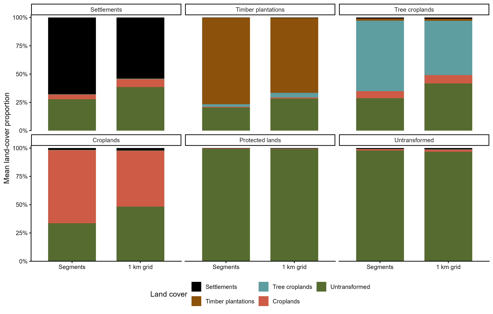
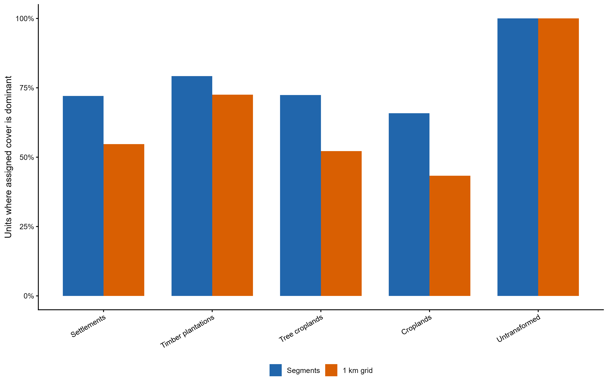

The page documents the technical decisions made during the segmentation process.

## Rationale and objective

The South African Biodiversity Intactness Index (BII) requires a consistent **spatial unit of assessment** to which a broad land-use class, land-use intensity, and eventually species information can be linked. Here, that unit is an image-derived *segment*: a group of neighbouring 30 m pixels (10 m embeddings averaged to a fixed 30 m grid) with similar landscape characteristics.

A regular grid (also called a fishnet), that is typically used in broad scale spatial workflows, is straightforward to reproduce, but its boundaries are imposed without reference to the landscape. A grid cell can therefore split fields or plantations, or combine very different land uses, imposing artificial boundaries on the landscape. Segmentation can follow landscape variation more closely, potentially producing units that more closely align with underlying vegetation structure, land use patterns, and management units, which provides a more appropriate basis for assigning land use intensity and estimating biodiversity intactness. In GEE land-cover studies, SNIC-based objects gave more accurate and spatially coherent maps than per-pixel classification of the same imagery [@tassi2020; @tassi2021].

Our aim in this part of the workflow is to select one nationally applicable segmentation configuration that balances land-cover homogeneity, recognisable landscape structure, consistency with the approximately 1 km analysis scale used in the regional BII, and a manageable number of units for national modelling. We tested various options for segmentation below.

## Data and segmentation methods

### Inputs and projection

We used the 2022 [Google Satellite Embedding V1](https://developers.google.com/earth-engine/datasets/catalog/GOOGLE_SATELLITE_EMBEDDING_V1_ANNUAL) collection (@brown). Each native 10 m pixel contained a 64-dimensional landscape representation. All 64 bands were supplied to [Simple Non-Iterative Clustering (SNIC)](https://developers.google.com/earth-engine/apidocs/ee-algorithms-image-segmentation-snic); i.e. they were not averaged across dimensions. SNIC formed connected objects from regularly spaced seeds according to feature similarity and spatial proximity [@achanta2017].

The sensitivity tests used SANBI's South African Albers Equal Area CRS (`AEA_RSA_WGS84`; WGS84 datum, central meridian 25° E, standard parallels 24° S and 33° S). The 10 m and 30 m grids shared a fixed origin and affine transforms of `[10, 0, 0, 0, -10, 0]` and `[30, 0, 0, 0, -30, 0]`, respectively. A fixed projection prevented GEE display scale from determining SNIC resolution. The national run used the same CRS and 30 m grid.

An earlier national run used the native \~20 m grid of SANLC 2022 in WGS84 (EPSG:4326; asset `SA_NLC_2022_GEO`). It was superseded by the final 30 m Albers run described under [National segmentation](#national-segmentation).

The 2022 South African National Land Cover (SANLC) classification was used **to evaluate**, not generate, segments. In the final national run it plays no part in segmentation: the study extent comes from the SANBI terrestrial boundary and no land-cover mask is applied, so land cover is linked to segments only after unique IDs have been assigned. Broad land-cover proportions were obtained from the BII crosswalk (`NLC_reclass_BII_land_use_intensity`), with protected-area overlap calculated separately. SANLC was assessed on the 10 m extraction grid during the sensitivity tests; its underlying land-cover information originated from the 20 m product.

### Sensitivity analysis

Two contrasting mixed-use rectangles were drawn in GEE: CT (Cape Town, including urban, industrial, tree croplands and mountain landscapes) and EC (Eastern Cape, including settlements, agriculture, plantations and natural vegetation). Each was buffered by 5 km during segmentation. Segments intersecting the test-area boundaries were excluded from comparisons.

We compared SNIC seed spacings of 600, 800, 1,000 and 1,200 m using 10 m embeddings. We then compared 10 m and 30 m embedding inputs at approximately 1,000 m seed spacing. For the 30 m scenario, each embedding band was spatially averaged from 10 m, and `size = 33` gave 990 m nominal spacing. Seed spacing controlled initial seed separation rather than final segment area.

`compactness = 1`, `connectivity = 8` and a 5 km buffer were held constant. The tests used `neighborhoodSize = 4 × size`; the subsequent national run used 66 pixels (`2 × 33`, the GEE default) to reduce processing demands. This change was not separately sensitivity-tested.

For each segment, we calculated the proportions of settlements, timber plantations, tree crops, croplands and untransformed land. The assigned BII class followed the first qualifying \>20% proportion in that order, followed by protected land (\>20% protected-area overlap), otherwise untransformed land. Protected land was an overlapping designation rather than a mutually exclusive cover type.

We assessed segment count, median area, area-weighted homogeneity (largest broad land-cover share), the proportion of assessed area in segments ≥80% homogeneous, and allocation retention (mapped area of a class occurring within segments assigned to that class). Composition figures represented pooled mapped hectares within each assigned class, not the mean segment. Repeated IDs in the test CSVs were combined using area-weighted proportions and boundary segments excluded; this procedure did not verify national ID uniqueness, which is now done separately (see [Globally unique segment IDs](#unique-ids)).

## Sensitivity results {#sensitivity-results}

Segmentation scenarios were evaluated using five metrics: (1) **segment count**, indicating computational requirements; (2) **median segment area** (ha); (3) **mean homogeneity**, calculated as the area-weighted mean proportion of the dominant land-cover class within each segment; (4) **area ≥80% homogeneous**, representing the percentage of total assessed area within segments dominated by a single land-cover class (≥80%); and (5) **transformed land-cover retention**, representing the proportion of mapped settlements, croplands, tree croplands and plantations occurring within segments assigned to their corresponding BII land-use class. Additionally, pooled land-cover composition was calculated to assess the mixture of land covers within each assigned BII class. Together, these metrics assessed the trade-off between computational efficiency and land-use representation.

### 1. Seed spacing

Increasing seed spacing reduced segment counts but increased land-cover mixing (Table 1). Moving from 800 to 1,000 m reduced segments by 36.9% in CT and 37.0% in EC, with homogeneity declining by only 1.1 and 2.1%, respectively. Median areas at 1,000 m were 91.0 ha (CT) and 89.8 ha (EC), close to the regional BII's 100 ha grid scale. We therefore selected approximately 1,000 m seed spacing.

Table 1. Segmentation metrics for four seed spacings. Counts and assessed areas excluded test-boundary segments. Homogeneity was the area-weighted dominant land-cover share; retention combined the four transformed covers.

| Site   |  Seed (m) |  Segments | Median (ha) | Assessed (ha) | Homogeneity (%) | ≥80% area (%) | Transformed retained (%) |
|:--------|--------:|--------:|--------:|--------:|--------:|--------:|--------:|
| CT     |       600 |     5,805 |        33.7 |       206,697 |            86.5 |          74.1 |                     92.2 |
| CT     |       800 |     3,209 |        58.4 |       202,547 |            84.6 |          69.1 |                     91.2 |
| **CT** | **1,000** | **2,024** |    **91.0** |   **198,480** |        **83.5** |      **66.3** |                 **90.0** |
| CT     |     1,200 |     1,396 |       128.4 |       193,667 |            82.4 |          64.8 |                     88.8 |
| EC     |       600 |     6,168 |        33.6 |       220,284 |            84.9 |          67.0 |                     88.5 |
| EC     |       800 |     3,409 |        57.8 |       215,810 |            82.5 |          61.5 |                     86.1 |
| **EC** | **1,000** | **2,146** |    **89.8** |   **211,269** |        **80.4** |      **57.6** |                 **83.7** |
| EC     |     1,200 |     1,463 |       127.1 |       207,434 |            78.6 |          51.4 |                     81.6 |

Table 2. Percentage of each mapped land-cover class retained in segments assigned to the same BII class. Protected land was excluded because it overlapped the land-cover categories.

| Site | Cover         | 600 m | 800 m | 1,000 m | 1,200 m |
|:-----|:--------------|------:|------:|--------:|--------:|
| CT   | Settlements   |  69.5 |  66.6 |    65.6 |    64.5 |
| CT   | Timber        |  74.2 |  69.9 |    68.6 |    66.7 |
| CT   | Tree crops    |  93.4 |  90.9 |    88.3 |    85.3 |
| CT   | Croplands     |  94.0 |  93.6 |    92.7 |    91.9 |
| CT   | Untransformed |  50.9 |  46.6 |    44.2 |    44.1 |
| EC   | Settlements   |  88.3 |  85.8 |    83.5 |    79.8 |
| EC   | Timber        |  96.2 |  95.5 |    94.1 |    94.0 |
| EC   | Tree crops    |  63.6 |   0.0 |     0.0 |     0.0 |
| EC   | Croplands     |  80.8 |  76.6 |    72.9 |    69.2 |
| EC   | Untransformed |  68.9 |  65.1 |    62.2 |    58.7 |

At coarser spacings, class retention generally declined. Tree crops were rare in EC, so their zero retention at 800–1,200 m was not considered representative of national performance. The pooled composition also showed substantial untransformed cover within assigned transformed classes, reflecting mixed land use and the 20% allocation threshold (@fig-seed-composition).

{#fig-seed-composition width="100%"}

### 2. Embedding resolution {#embedding-resolution}

At approximately 1,000 m spacing, moving from 10 m to 30 m reduced the SNIC input pixel count by 88.9% (ninefold fewer pixels). Mean homogeneity changed by −0.5 percentage points in CT and +0.2 in EC, with similarly small differences in transformed-cover retention (Table 3). The 30 m input therefore offered a substantial computational saving without materially reducing the evaluated land-cover homogeneity. Its seed spacing was 990 m, compared with 1,000 m for the 10 m input.

Table 3. Comparison of segmentation metrics for 10 m and spatially averaged 30 m embeddings at approximately 1 km seed spacing.

| Site | Input | Segments | Median (ha) | Assessed (ha) | Homogeneity (%) | ≥80% area (%) | Transformed retained (%) |
|:--------|:--------|--------:|--------:|--------:|--------:|--------:|--------:|
| CT   | 10m   |    2,024 |        91.0 |       198,480 |            83.5 |          66.3 |                     90.0 |
| CT   | 30m   |    2,084 |        93.9 |       201,091 |            83.0 |          65.8 |                     89.3 |
| EC   | 10m   |    2,146 |        89.8 |       211,269 |            80.4 |          57.6 |                     83.7 |
| EC   | 30m   |    2,218 |        92.4 |       214,558 |            80.6 |          57.4 |                     84.2 |

Class-specific retention remained similar between resolutions, as did the pooled composition of the assigned BII classes (@fig-resolution-composition).

Table 4. Percentage of original mapped land cover retained within its assigned BII class, for the two embedding resolutions.

| Site | Cover         | 10 m | 30 m |
|:-----|:--------------|-----:|-----:|
| CT   | Settlements   | 65.6 | 64.3 |
| CT   | Timber        | 68.6 | 65.6 |
| CT   | Tree crops    | 88.3 | 90.1 |
| CT   | Croplands     | 92.7 | 91.5 |
| CT   | Untransformed | 44.2 | 45.8 |
| EC   | Settlements   | 83.5 | 83.3 |
| EC   | Timber        | 94.1 | 94.4 |
| EC   | Tree crops    |  0.0 |  0.0 |
| EC   | Croplands     | 72.9 | 74.3 |
| EC   | Untransformed | 62.2 | 63.1 |

{#fig-resolution-composition width="100%"}

## National segmentation {#national-segmentation}

The final national run (version 6 of the GEE script, reproduced at the end of this section) segmented the 2022 embeddings, all 64 dimensions, averaged from 10 m to the same fixed 30 m Albers grid used in the sensitivity tests, with the parameters in Table 5. An earlier version of the GEE script, which ran SNIC on the \~20 m SANLC grid, is available [her](https://code.earthengine.google.com/5c2a91aa071b5b038ded470d34f434c0)[e](https://code.earthengine.google.com/1301611503a074f06100e8cdfd2f03b2).

The sensitivity analysis showed that 30 m embeddings give practically the same land-cover homogeneity and class retention as 10 m embeddings, with ninefold fewer pixels (see [Embedding resolution](#embedding-resolution)). The national run therefore used 30 m with `size = 33`, i.e. 990 m seed spacing. The raw SNIC `clusters` band was renamed `raw_snic_id`, cast to Int32 and exported as a single-band GEE asset.

Table 5. Parameters of the national SNIC run (GEE script v6).

| Parameter          | Value                                                                                                                                                | Reasoning                                                                                                                                                                                                                             |
|:-----------------------|:-----------------------|:-----------------------|
| Input              | 2022 Satellite Embedding V1 (annual), all 64 bands, mosaicked and clipped to the processing area                                                     | Full embedding retained; no dimension averaging                                                                                                                                                                                       |
| Resolution         | 30 m: mean of the 10 m pixels (`reduceResolution` with `ee.Reducer.mean()`, `maxPixels = 64`), followed by one explicit `reproject` to the 30 m grid | Practically the same homogeneity and retention as 10 m with ninefold fewer pixels. The explicit projection prevents GEE from silently running SNIC at a coarser scale, which would create oversized segments                          |
| CRS / grid         | SANBI Albers Equal Area (`AEA_RSA_WGS84`), `crsTransform = [30, 0, 0, 0, -30, 0]`, sharing its origin with the 10 m grid                             | Pins scale *and* origin, so `size` is measured in pixels of this grid; identical to the sensitivity tests                                                                                                                             |
| `size`             | 33 pixels (990 m seed spacing)                                                                                                                       | Retains the \~1 km spacing consistent with the \~100 ha regional BII grid                                                                                                                                                             |
| `compactness`      | 1.0                                                                                                                                                  | As in the sensitivity tests; a value of 2 made segments too square                                                                                                                                                                    |
| `connectivity`     | 4                                                                                                                                                    | Pixels join a segment only through shared edges, not corners, which avoids diagonal-only joins and narrow fingers. Matches the 4-direction rule used to assign unique IDs, so a segment is defined the same way in GEE and afterwards |
| `neighborhoodSize` | 66 pixels (2 × `size`, the GEE default)                                                                                                              | Reduces seams between SNIC computation tiles at manageable processing cost; not separately sensitivity-tested                                                                                                                         |
| Processing area    | SANBI terrestrial boundary (`SA_boundary_ter`, provinces dissolved into one outline) buffered by 1,000 m                                             | Restricts SNIC to South Africa while giving segments context across the border and coastline                                                                                                                                          |
| Land-cover mask    | None                                                                                                                                                 | Masking by land cover before unique IDs are assigned could split connected segments. Unsuitable segments (e.g. mostly water) are identified afterwards from their land-cover composition                                              |
| Output             | `clusters` band renamed `raw_snic_id`, Int32; GEE asset `Segmentation_SA_2022_30m_990m_C4_K1_NATIONAL` (pyramiding policy `sample`)                  | Int32 is widely supported by GIS software; the asset keeps the original labels and mask                                                                                                                                               |

**How these choices compare with other SNIC studies.** SNIC has no universal parameter set: seed spacing and compactness are tuned to the image resolution and the size of the objects of interest. Studies using SNIC in GEE have set them by repeated trials and visual inspection of segment outputs [@tassi2020; @tassi2021; @vizzari2025]. We followed the same principle but tested seed spacing quantitatively against SANLC homogeneity and class retention (see [Sensitivity results](#sensitivity-results)). Seed spacing sets the expected segment size [@achanta2017]. Those studies delineated individual fields and land-cover patches from 10–30 m Sentinel-2 and Landsat 8 imagery [@tassi2020; @tassi2021; @vizzari2025], whereas our 1 km spacing deliberately targets landscape units at the scale of the regional BII rather than individual fields. Compactness weights spatial distance against feature similarity in SNIC [@achanta2017]: higher values give more regular, grid-like superpixels, and lower values follow image boundaries more closely. A moderate value (1.0) keeps 1 km segments reasonably regular in shape while still letting them follow landscape boundaries in the embedding space. SNIC grows each segment only through neighbouring pixels, so every cluster is spatially connected when it is formed [@achanta2017]. Defining that neighbourhood with 4-connectivity is therefore what makes SNIC objects agree with the unique segment IDs, which use the same rule. Where GEE's processing tiles meet, however, a cluster can be cut into separate pieces (see [Globally unique segment IDs](#unique-ids)).

The processing area was the SANBI terrestrial boundary, with the internal provincial boundaries dissolved, buffered by 1,000 m; the embeddings were clipped to it before SNIC. The export region was the bounding rectangle of this area, but only pixels inside the buffered boundary carry labels; all others are masked. No land-cover mask was applied, so water and coastal pixels within the buffer keep their SNIC labels, and segments that cross the outer edge of the buffer are truncated there. The asset was downloaded to R with `rgeedim::gd_download()`, which assembles its download tiles into one GeoTIFF (`SA_SNIC_2022_30m_download.tif`, 563 MB); masked pixels are NoData (−2,147,483,648).

### Results of the national run

Table 6. Results of the national SNIC run. Segment counts and areas refer to the globally unique segments (see [Globally unique segment IDs](#unique-ids)).

| Quantity                                   | Value                                                                    |
|:-----------------------------------|:-----------------------------------|
| Raster                                     | 53,886 columns × 47,102 rows (2,538,138,372 cells) at 30 m, Int32        |
| Labelled pixels                            | 1,364,491,257 (1,228,042 km²)                                            |
| Distinct raw SNIC IDs                      | 1,252,801                                                                |
| Segments (globally unique IDs)             | 1,268,426                                                                |
| Segment area, median (interquartile range) | 96.2 ha (73.5–119.2 ha)                                                  |
| Segment area, 5th–95th percentile          | 33.8–160.5 ha                                                            |
| Segment area, mean / maximum               | 96.8 ha / 410.4 ha                                                       |
| Segments \< 10 pixels (\< 0.9 ha)          | 9,063 (0.71% of segments; 2,628 ha), mostly slivers along GEE tile edges |

The national median segment area (96 ha) is close to the medians of the 30 m sensitivity tests (93.9 ha in CT and 92.4 ha in EC; Table 3) and to the \~100 ha grid scale of the regional BII.

::: callout-note
## Notes for future runs

-   An earlier national run on the \~20 m SANLC grid used up the GEE contributor-tier monthly compute quota, partly because SNIC was computed over the full SANLC bounding box, well beyond the South African border. The v6 run clips the embeddings to the SANBI boundary plus a 1 km buffer *before* SNIC, and runs at 30 m.
-   The segments (30 m Albers) and SANLC 2022 (\~20 m, EPSG:4326) are on different grids, so land-cover composition per segment needs resampling or an area-weighted overlay in the allocation step.
-   Two comments in the v6 script are out of date: the buffer is 1,000 m (`BUFFER_M`), not 100 m, and unique IDs are assigned as described under [Globally unique segment IDs](#unique-ids) rather than with `terra::patches()`.
:::

::: {.callout-note collapse="true"}
## GEE script for the national run (v6)

``` javascript
// ============================================================================
// BII SOUTH AFRICA | 2022 AlphaEarth SNIC | v6
// Output: raw SNIC labels on a fixed 30 m South African Albers grid.
// SNIC context: dissolved SANBI terrestrial boundary + 100 m buffer.
// Final output: all SNIC labels within buffered SANBI boundary; NO NLC mask.
// Next step: terra::patches(..., directions=4, values=TRUE) in R.
// Land cover and exclusions are classified AFTER permanent IDs are assigned.
// ============================================================================

// 1. SETTINGS ---------------------------------------------------------------
var STAGE = 'NATIONAL';          // 'TEST' or 'NATIONAL'
var DEST = 'ASSET';              // 'ASSET' or 'DRIVE'
var ROOT = 'projects/thicket-ecological-condition/assets/BII_SA/';
var BOUNDARY_ASSET = ROOT + 'SA_boundary_ter';
var DRIVE_FOLDER = 'BII_SA_segmentation';

var RES_M = 30;                  // 10 m -> 30 m: ~9x fewer pixels nationally
var SEED_PIXELS = 33;           // 33 x 30 m = 990 m, target ~1 km2 units
var COMPACTNESS = 1.0;          // Smoother than 1; 2 made units too square
var CONNECTIVITY = 4;          // Avoid diagonal-only joins / narrow fingers
var NEIGHBORHOOD_PIXELS = 66;   // 2x seeds; reduce SNIC computation-tile seams
var BUFFER_M = 1000;            // Buffer in m beyond official SA boundary, NLC has buffer too

var TEST_ROI = geometry;

// 2. EXACT ALBERS GRID -------------------------------------------------------
// Custom SA equal-area CRS, NOT ESRI:102022. Grids share the same origin.
// SNIC's 'size' is measured in pixels of this 30 m grid, NOT metres.
var CRS =
  'PROJCS["AEA_RSA_WGS84",' +
  'GEOGCS["GCS_WGS_1984",DATUM["D_WGS_1984",' +
  'SPHEROID["WGS_1984",6378137,298.257223563]],' +
  'PRIMEM["Greenwich",0],UNIT["Degree",0.0174532925199433]],' +
  'PROJECTION["Albers"],' +
  'PARAMETER["false_easting",0],' +
  'PARAMETER["false_northing",0],' +
  'PARAMETER["central_meridian",25],' +
  'PARAMETER["standard_parallel_1",-24],' +
  'PARAMETER["standard_parallel_2",-33],' +
  'PARAMETER["latitude_of_origin",0],UNIT["Meter",1]]';

var GRID10 = [10, 0, 0, 0, -10, 0];
var GRID30 = [30, 0, 0, 0, -30, 0];
var PROJ10 = ee.Projection(CRS, GRID10);
var PROJ30 = ee.Projection(CRS, GRID30);

// 3. NATIONAL GEOMETRY -------------------------------------------------------
// Dissolve the provincial outlines to remove internal province boundaries.
var provinces = ee.FeatureCollection(BOUNDARY_ASSET);
var SA = provinces.geometry(100).dissolve(100);
var AOI = (STAGE === 'TEST') ? TEST_ROI : SA;
var WORK = AOI.buffer(BUFFER_M, 100);

// 4. EMBEDDINGS: MEAN 10 m -> FIXED 30 m ------------------------------------
// Mosaic requires an explicit projection; otherwise SNIC can silently run
// at an unintended coarse scale and create vastly oversized segments.
var input10 = ee.ImageCollection('GOOGLE/SATELLITE_EMBEDDING/V1/ANNUAL')
  .filterDate('2022-01-01', '2023-01-01')
  .filterBounds(WORK)
  .mosaic()
  .clip(WORK)
  .setDefaultProjection(PROJ10);

// One intentional reprojection locks aggregation and SNIC to 30 m Albers.
var input30 = input10.reduceResolution({
  reducer: ee.Reducer.mean(),
  maxPixels: 64
}).reproject({crs: PROJ30});

// 5. SNIC: COMPLETE RAW LABELS (NO NLC MASK) --------------------------------
var rawLabels = ee.Algorithms.Image.Segmentation.SNIC({
  image: input30,
  size: SEED_PIXELS,
  compactness: COMPACTNESS,
  connectivity: CONNECTIVITY,
  neighborhoodSize: NEIGHBORHOOD_PIXELS
})
  .select('clusters')
  .rename('raw_snic_id')
  .toInt32()
  .clip(WORK);

// 6. NO LAND-COVER MASK ------------------------------------------------------
// Keep every SNIC segment pixel within WORK, including water and offshore
// pixels. Applying an NLC mask now could split connected SNIC segments before
// permanent IDs are assigned in R. Classify predominantly unsuitable
// segments as "to_exclude" later using NLC composition and a documented rule.
// A 100 m processing buffer means segments touching the outer WORK boundary
// can still be truncated there; no country or NLC clipping is done afterwards.

// 7. DIAGNOSTICS ------------------------------------------------------------
var NAME = 'Segmentation_SA_2022_30m_990m_C4_K1_' + STAGE;
print('Stage / destination', STAGE, DEST);
print('SANBI boundary asset', BOUNDARY_ASSET);
print('Provincial features', provinces.size());
print('Dissolved SA area (km2)', SA.area(1000).divide(1e6));
print('Embeddings bands (expect 64)', input10.bandNames().size());
print('30 m analysis projection / transform', input30.projection());
print('SNIC label datatype', rawLabels.bandTypes());
print('Seed spacing (m), buffer (m)', SEED_PIXELS * RES_M, BUFFER_M);
print('Connectivity, compactness, neighborhood',
      CONNECTIVITY, COMPACTNESS, NEIGHBORHOOD_PIXELS);
print('Export name', NAME);

// 8. EXPORT -----------------------------------------------------------------
// One national SNIC computation. The export envelope is a rectangle, but
// the raw SNIC mask limits retained pixels to WORK / embedding coverage.
if (DEST === 'ASSET') {
  // GEE Asset retains the original Int32 labels and image mask. No sentinel.
  Export.image.toAsset({
    image: rawLabels,
    description: NAME,
    assetId: ROOT + NAME,
    region: WORK.bounds(1000),
    crs: CRS,
    crsTransform: GRID30,
    pyramidingPolicy: {raw_snic_id: 'sample'},
    maxPixels: 1e13
  });
} else if (DEST === 'DRIVE') {
  // Safe all-Int32 transport: 2 bands (raw label + 0/1 validity).
  // No NoData sentinel is used, so negative or zero SNIC labels remain valid.
  // In R, mask the first band using the second band BEFORE patches().
  var labelsForDrive = rawLabels
    .unmask({value: 0, sameFootprint: false})
    .rename('raw_snic_id');
  var validForDrive = rawLabels.mask()
    .unmask({value: 0, sameFootprint: false})
    .rename('valid_pixel').toInt32();
  var driveImage = labelsForDrive.addBands(validForDrive)
    .toInt32().clip(WORK);

  Export.image.toDrive({
    image: driveImage,
    description: NAME,
    fileNamePrefix: NAME,
    folder: DRIVE_FOLDER,
    region: WORK.bounds(1000),
    crs: CRS,
    crsTransform: GRID30,
    fileDimensions: 8192,     // TIFF shards, NOT separate SNIC segmentations
    skipEmptyTiles: true,
    fileFormat: 'GeoTIFF',
    maxPixels: 1e13
  });
} else {
  throw new Error('DEST must be ASSET or DRIVE.');
}
```

The national run used `DEST = 'ASSET'`; the asset was then downloaded with `rgeedim` as described above.
:::

## Globally unique segment IDs {#unique-ids}

Because GEE processes images in tiles, SNIC is computed tile by tile across the country. Although SNIC considers neighbouring pixels when delineating segments (`neighborhoodSize`), the resulting raw IDs are not globally unique: spatially disconnected segments can share the same ID. Globally unique IDs are essential for consistently linking land use, land-use intensity, species data and other attributes to individual segments. Ensuring this uniqueness requires an additional processing step, complicated by the size of the national raster (2.54 billion cells) and by the integer data types that different GIS platforms support. This section documents how every segment received a unique Int32 ID, why the GEE and R options were not suitable, and how the result was verified, in enough detail to reproduce it.

::: callout-note
## Summary

-   **Result:** 1,268,426 segments with IDs 1 to 1,268,426 in a single Int32 GeoTIFF on the original 30 m grid, plus a lookup table linking each ID to its raw SNIC ID and pixel count.
-   **Why relabel:** 14,110 raw SNIC IDs occur as two or more spatially separate segments (29,735 segments). Most are single SNIC clusters cut into pieces by GEE's 256 × 256-pixel processing tiles; 207 are unrelated clusters that share the same ID by chance.
-   **Why not GEE or terra:** `ee.Image.connectedComponents()` returns Int64 and masks objects larger than 1,024 pixels. The installed `terra::patches()` (terra 1.8-29) runs only in memory (75.6 GB needed here), indexes cells with 32-bit integers and is known to crash R; it stops with "cannot do this for large rasters".
-   **Method:** out-of-core connected-component labelling in strips, with union-find to join segments across strip boundaries (Python: cc3d, SciPy, rasterio), called from R. About 4 minutes on a 32 GB laptop; peak memory 3.8 GB.
-   **Verification:** an independent relabelling (scikit-image, different strip boundaries) produced the identical 1,268,426 segments one-to-one; all 2.73 billion pairs of adjacent pixels obey the segment rule; a full re-run reproduced every pixel value exactly.
:::

### Why the raw SNIC IDs are not unique

A **segment** is defined here as a *4-connected region of identical raw SNIC ID*: a set of pixels with the same raw ID, each linked to the next through a shared pixel edge (not just a corner). This matches `connectivity = 4` in SNIC, where clusters grow only through edge neighbours [@achanta2017], and it is the same rule used by `terra::patches(values = TRUE, directions = 4)` and WhiteboxTools *Clump* (`diag = FALSE`). NoData pixels never belong to a segment; a raw ID of 0 is treated as a valid ID.

The raw IDs span almost the whole Int32 range (−2,147,477,888 to 2,147,481,461) and behave like random 32-bit numbers rather than a 1, 2, 3 … sequence. They are not unique: the raster contains 1,252,801 distinct raw IDs but 1,268,426 separate segments. 14,110 raw IDs occur as two or more spatially separate segments (29,735 segments in total; at most 6 per raw ID). Joining species or land-use data on the raw ID would therefore pool data from different places.

Two mechanisms explain the repeats. They can be told apart by the distance between the pieces that share a raw ID (Table 7).

Table 7. Raw SNIC IDs that occur as more than one segment, grouped by the largest distance between the centroids of their pieces.

| Mechanism                                     | Max. distance between pieces |    Raw IDs |
|:----------------------------------|---------------------:|---------------:|
| One SNIC cluster cut into separate pieces     |                      \< 1 km |      7,040 |
|                                               |                       1–2 km |      5,785 |
|                                               |                       2–5 km |      1,076 |
| Unclear                                       |                      5–50 km |          2 |
| Different clusters that share an ID by chance |      ≥ 50 km (median 643 km) |        207 |
| **Total**                                     |                              | **14,110** |

**Clusters cut by GEE tiles (13,901 raw IDs).** GEE computes SNIC tile by tile and stitches the tiles together. The `neighborhoodSize` parameter (66 pixels here) reduces, but does not remove, tile-boundary artefacts. Where neighbouring tiles disagree slightly about a cluster's extent, the cluster keeps its raw ID but can end up as several disconnected pieces. Two observations support this:

-   The 9,063 segments smaller than 10 pixels sit on a regular grid with a 256-pixel spacing. 95.0% of them lie within 2 pixels of a row or column of that grid, compared with 3.9% expected at random and 4.7% for all segments. This matches GEE's 256 × 256-pixel computation tiles.
-   72.5% of the smaller pieces of cut clusters (n = 15,411) also lie on these tile edges (@fig-split-example).

**Chance collisions (207 raw IDs).** If 1,252,801 IDs are drawn at random from the 2^32^ possible 32-bit values, the expected number of pairs sharing an ID is

$$
E \approx \frac{n^2}{2 \times 2^{32}} = \frac{1{,}252{,}801^2}{8{,}589{,}934{,}592} \approx 183,
$$

which is the same order as the 207 raw IDs whose pieces lie 50 km or more apart.

{#fig-split-example width="100%"}

Both problems are solved by relabelling: every 4-connected region of identical raw ID receives its own ID, so the pieces of a cut cluster become separate segments. The 9,063 fragments under 10 pixels make up 0.71% of segments and 0.002% of the mapped area (2,628 ha).

### Options considered

**GEE `connectedComponents()`.** `ee.Image.connectedComponents()` can identify image objects and assign a unique ID to each: all pixels belonging to an object receive the same integer, in an additional `labels` band based on the connectivity of pixels in the first band of the image. However, the output is a 64-bit integer (Int64) raster, whereas SNIC outputs signed 32-bit integer (Int32) cluster IDs. Many GIS applications and raster-processing tools have limited support for Int64 values, whereas Int32 is widely compatible and provides more than enough unique IDs for our segments. In addition, `connectedComponents()` limits objects to `maxSize` = 1,024 connected pixels and masks larger ones. At 30 m, 1,024 pixels are only 92 ha, and 54.8% of the national segments (69.8% of the labelled area) are larger. The function was therefore considered inappropriate; the raw SNIC labels are exported as Int32 and unique IDs are assigned outside GEE.

**`terra::patches()` in R.** The original plan was `terra::patches(snic, values = TRUE, directions = 4, ...)`. With the installed terra version (1.8-29) this cannot work for a national 30 m raster. We checked the package's C++ source (`src/patches.cpp`, which implements `patches(values = TRUE)` as the method `patches2`) and terra's own memory estimate (`terra::mem_info()`), summarised in Table 8.

Table 8. Limitations of `terra::patches(values = TRUE)` in terra 1.8-29 [@hijmans2025terra] for this raster.

| Limitation in terra 1.8-29                                                                                                                                                                            | Consequence for the 2,538,138,372-cell raster                                                                                                                                                                        |
|:-----------------------------------|:-----------------------------------|
| In-memory only: the function first checks whether the raster fits in memory and otherwise stops with *"cannot do this for large rasters"* (the block-by-block version is commented out in the source) | `mem_info()` reports 75.6 GB needed versus 8.9 GB allowed (70% of the free RAM on a 32 GB laptop), so it stops immediately                                                                                           |
| Reads all cell values into one vector of 8-byte doubles and allocates a second one for the patch numbers                                                                                              | 2 × 2.54 billion × 8 bytes = 40.6 GB, more than the laptop's total RAM                                                                                                                                               |
| Cell positions are passed as 32-bit integers (`const int &i`)                                                                                                                                         | The largest 32-bit integer is 2,147,483,647, so cell indices overflow from row 39,853 of 47,102 onwards (the southern \~15% of the raster), giving out-of-bounds memory access                                       |
| Recursive depth-first search: one nested function call per pixel of a patch                                                                                                                           | The maintainer described it as "not memory safe yet"; [issue #1758](https://github.com/rspatial/terra/issues/1758), "patches(, values=TRUE) crashes R", was reported for an 8-million-cell raster on a 64 GB machine |

`patches()` was rewritten for terra 1.9-1 ([pull request #2006](https://github.com/rspatial/terra/pull/2006), January 2026). The new version replaces the depth-first search with a block-wise, two-pass union-find, which is the same strategy used below. That version has not been tested on this raster; it may allow an R-only workflow in future.

**WhiteboxTools *Clump*.** On a 973 × 960-pixel test raster it produced exactly the same segments as `terra::patches()` and the method below (909 segments; see [Verification](#verification)). It was not tested at national scale because it requires too much RAM.

### Method: out-of-core connected-component labelling

Assigning IDs to connected regions is a standard image-processing task called *connected-component labelling*. A raster too large to hold in memory can be processed in horizontal **strips** with the classic two-pass approach [@wu2009]:

1.  label each strip on its own;
2.  record where a region continues across the boundary (*seam*) between two strips;
3.  merge those records with a *union-find* (disjoint-set) algorithm [@tarjan1975], so each region gets exactly one ID.

Only one strip is in memory at a time, so memory use does not depend on the size of the raster (@fig-workflow).

```{mermaid}
%%| label: fig-workflow
%%| fig-cap: "Workflow of 01b_assign_unique_segment_ids.py. The raw raster is read in strips twice (pass 1 and pass 2) and twice more for the independent verification."
flowchart TD
    A["Raw SNIC raster<br/>Int32, 2.54 billion cells"] --> B["Read one strip<br/>2,048 rows x 53,886 columns"]
    B --> C["Label 4-connected regions of<br/>identical raw ID in the strip (cc3d)"]
    C --> D["Make labels unique across strips<br/>(add offset) and record seam links"]
    D -->|"next strip"| B
    D --> E["Union-find: merge linked labels;<br/>number segments 1..N in raster order"]
    E --> F["Pass 2: relabel every strip and write<br/>Int32 GeoTIFF + lookup table"]
    F --> G["Independent verification<br/>(scikit-image, different strips)"]
    G -->|"all checks pass"| H["Final raster, lookup CSV, QC report"]
```

The steps below follow the section numbers in the annotated script `01b_assign_unique_segment_ids.py`.

**1. NoData encoding (script section 2).** Connected-component libraries treat 0 as background, but 0 could be a valid SNIC ID. Each Int32 value is therefore re-interpreted as an unsigned 32-bit integer with its sign bit flipped. This one-to-one mapping sends only the NoData value to 0 and needs no extra memory (Table 9).

Table 9. Examples of the NoData encoding.

|       Raw value (Int32) |     Bits     | Key used for labelling |
|------------------------:|:------------:|-----------------------:|
| −2,147,483,648 (NoData) | `0x80000000` |         0 (background) |
|                       0 | `0x00000000` |          2,147,483,648 |
|                      −1 | `0xFFFFFFFF` |          2,147,483,647 |
|           2,147,483,647 | `0x7FFFFFFF` |          4,294,967,295 |

**2. Strip labelling (pass 1, script section 3).** The raster is read in 23 strips of 2,048 rows across the full width (110 million cells, 0.44 GB per strip). In each strip, the C++ library cc3d [@silversmith2026cc3d] labels every 4-connected region of identical key with a local number 1…n. Adding the number of labels already issued in earlier strips (an offset) makes these provisional labels unique across the whole raster. Pass 1 produced 1,303,109 provisional labels in about 15 s.

**3. Seam links (pass 1).** Under 4-connectivity, pixels in two different strips can only touch vertically. A region can therefore cross a seam only where the last row of one strip and the first row of the next have the same raw ID in the same column. Each such pair of provisional labels is recorded once (Table 10). Diagonal contacts are ignored. Pass 1 recorded 34,683 seam links.

Table 10. How seam links are recorded (pN = provisional label).

| Column                                   |     1     |      2       |     3     |      4      |
|:-------------------------|:----------:|:----------:|:----------:|:----------:|
| Last row of strip *k*: raw ID (label)    |  7 (p12)  |   7 (p12)    |  9 (p13)  |   9 (p13)   |
| First row of strip *k*+1: raw ID (label) |  7 (p40)  |   5 (p41)    |  9 (p42)  |   9 (p42)   |
| Link recorded                            | p12 = p40 | none (7 ≠ 5) | p13 = p42 | (duplicate) |

**4. Union-find and numbering (script section 4).** Provisional labels become the nodes of a graph and seam links its edges. The connected components of this graph are the segments. This also handles regions that cross several seams, or whose arms only meet further down (for example a U shape), because the merge is transitive. SciPy's `connected_components()` [@virtanen2020] performs the union-find step. Segments are numbered 1 to N in the order in which their first pixel is met when reading the raster row by row from the top-left corner. The numbering is therefore consecutive, has no gaps and is identical every time the same input is processed. The 1,303,109 provisional labels resolve to 1,268,426 segments, far below the Int32 maximum of 2,147,483,647.

**5. Relabelling and writing (pass 2, script section 5).** Storing the provisional labels between passes would need a 10 GB temporary file. Instead, each strip is read and labelled again. Labelling is deterministic, and the label count and a CRC-32 checksum are compared with pass 1 to prove it. A small lookup array then converts each local label to its final ID, and the strip is written to the output GeoTIFF (Table 11). At the same time, the pixel count and raw SNIC ID of every segment are collected. If any final ID were found with two different raw IDs, the run would stop; this count was 0.

Table 11. Output GeoTIFF settings.

| Setting     | Value                                               | Reason                                                                        |
|:--------------|:----------------------|:----------------------------------|
| Data type   | Int32                                               | Required for compatibility; IDs 1–1,268,426 fit easily                        |
| NoData      | −2,147,483,648                                      | Same as the input; can never be an ID                                         |
| Grid, CRS   | Identical to the input                              | Pixel-for-pixel alignment with the raw raster; no resampling                  |
| Tiling      | 512 × 512 pixels                                    | Efficient reading of windows in R, QGIS and ArcGIS                            |
| Compression | DEFLATE, predictor 2                                | Runs of the same ID compress to almost nothing (334 MB including overviews)   |
| BigTIFF     | Yes                                                 | The uncompressed size (10 GB) exceeds the 4 GB limit of classic TIFF          |
| Overviews   | Internal, nearest neighbour                         | Fast display; nearest neighbour never averages IDs into IDs that do not exist |
| Metadata    | Band name `segment_id`, statistics, provenance tags | Visible with `terra::describe()` or `gdalinfo`                                |

**6. Lookup table and QC report (script section 7).** A CSV with one row per segment (`segment_id`, `raw_snic_id`, `n_pixels`) and a plain-text QC report are written. The raster is first written under a temporary name (`*.partial.tif`) and only renamed after it has passed verification, so a failed run never leaves a final-looking file.

**Efficiency.** On a Windows laptop with 32 GB RAM and 24 logical cores, pass 1 took about 15 s, pass 2 with writing about 45 s, verification 2–2.5 minutes and overviews 15–20 s: 3.5–4 minutes in total across two runs. Peak memory was 3.8 GB, compared with at least 40 GB for any approach that holds the whole raster in memory. The 563 MB compressed input is read four times (twice for labelling, twice for verification) using all CPU cores for decompression (rasterio/GDAL), and no large temporary files are written. NumPy [@harris2020] handles all array operations.

### Verification {#verification}

The script verifies the file it has written against an **independent** relabelling. This uses a different library (scikit-image, @vanderwalt2014, instead of cc3d) and a different strip height (1,000 instead of 2,048 rows), so none of its seams coincide with those used to create the IDs. Every pixel is compared (Table 12). The output only receives its final file name if every check passes.

Table 12. Verification of the national output (from `logs/segment_id_qc.txt`).

| Check                      | What it tests                                                                                                            | Result                              |
|:--------------|:-----------------------------------------|:--------------|
| Independent segment count  | scikit-image finds the same number of segments                                                                           | 1,268,426 = 1,268,426               |
| ID re-used for two regions | No output ID covers two independently found segments, i.e. IDs are globally unique                                       | 0 pixels                            |
| Region split over two IDs  | No independently found segment is split across two output IDs                                                            | 0 pixels                            |
| 4-neighbour rule           | For every pair of adjacent valid pixels (horizontal and vertical, including across strips): same raw ID ⇔ same output ID | 0 of 2,728,816,097 pairs violate it |
| NoData                     | Output is NoData exactly where the input is NoData                                                                       | 0 mismatches                        |
| ID range                   | Every valid pixel has an ID between 1 and N                                                                              | 0 out of range                      |
| ID → raw ID                | The lookup's `raw_snic_id` equals the raw raster at every pixel                                                          | 0 mismatches                        |
| Pixel counts               | `n_pixels` in the lookup equals the count in the raster for every ID                                                     | 0 mismatches                        |
| No gaps                    | Every ID from 1 to N occurs                                                                                              | 0 unused IDs                        |

Additional checks:

-   **Comparison with terra and WhiteboxTools.** On the 973 × 960-pixel QA raster (`data/benchmark_clumps`), the method produced the same 909 segments as `terra::patches(values = TRUE, directions = 4)` and WhiteboxTools *Clump*, one-to-one. That raster has only 860 distinct raw IDs, so 49 additional segments are pieces of repeated raw IDs.
-   **Algorithm tests.** Before the national run, strip-wise results were compared with labelling the whole array in memory, for strip heights down to a single row. The cases were synthetic patterns designed to break seam handling (combs joined only at the top or bottom, a serpentine region crossing every seam, checkerboards that repeat the same values, a raw ID of 0, extreme Int32 values, all-NoData strips) and a real 6,000 × 7,000-pixel window of the national raster (39,572 segments). All were identical.
-   **Check in R.** `01_segment_ids.R` (step 4) reopens the result with terra and confirms the data type (`INT4S`), the grid, IDs 1 to N, and agreement of the NoData pattern and raw IDs with the raw raster at 20,000 random cells.
-   **Reproducibility.** Running `01_segment_ids.R` again end to end produced a lookup table that was byte-for-byte identical and the same value in all 2,538,138,372 raster cells (`logs/segment_id_qc_reproduction_run.txt`).

### Outputs and use in the next steps

Table 13. Files produced (in the `Segment_ids` project).

| File                                                        | Content                                                                                       |
|:---------------------------|:------------------------------------------|
| `output/BII_segments_SA_uniqueID_AEA_30m_2022.tif`          | Unique segment IDs (Int32, 1–1,268,426), same 30 m grid as the raw SNIC raster                |
| `output/BII_segments_SA_uniqueID_AEA_30m_2022_lookup.csv`   | One row per segment: `segment_id`, `raw_snic_id`, `n_pixels` (area in ha = `n_pixels` × 0.09) |
| `logs/segment_id_qc.txt`                                    | QC and verification report of the delivered files                                             |
| `logs/segment_id_qc_reproduction_run.txt`                   | Report of the reproduction run (identical result)                                             |
| `logs/raw_id_diagnostics.txt`, `logs/raw_id_duplicates.csv` | Diagnostics of repeated raw IDs (Table 7), from `01c_raw_id_diagnostics.py`                   |

Using the IDs in the next step, for example to attach species occurrence points to segments in R:

``` r
library(terra)
seg <- rast("output/BII_segments_SA_uniqueID_AEA_30m_2022.tif")
lut <- data.table::fread("output/BII_segments_SA_uniqueID_AEA_30m_2022_lookup.csv")

pts <- vect(occ, geom = c("lon", "lat"), crs = "EPSG:4326")   # occ: data.frame of records
pts <- project(pts, crs(seg))                                 # to SA Albers
occ$segment_id <- extract(seg, pts)$segment_id                # NA outside the labelled area
occ <- merge(occ, lut, by = "segment_id", all.x = TRUE)       # add raw ID and segment size
```

### Raster to vector

Polygonisation is not needed to assign unique IDs or to calculate land-use allocation and intensity: these zonal statistics can be computed directly on the raster. If vector geometries are needed later (e.g. to associate species distributions with segments), we will vectorise with open-source software for reproducibility: GDAL Polygonize, accessed through QGIS or in R with the gdalraster package.

Self-intersecting polygons need to be considered when vectorising. E.g. a square pixel may share a corner with its segment, but 3 borders with the neighbouring segment. When this pixel converts to a polygon, the connectedness (connectivity) parameter determines whether it remains with its original segment's polygon (i.e. a multipart polygon) or becomes its own polygon. gdalraster explicitly warns that 8-connected can produce invalid geometries (which ArcPro for e.g. can't read). Because the segments were built and labelled with 4-connectivity, vectorising with 4-connectedness keeps polygons consistent with the segment IDs: every ID is exactly one 4-connected region, so it becomes exactly one polygon (possibly with holes).

### How to reproduce

**Software.** Windows 11, R 4.3.3 with terra 1.8-29 and rgeedim 0.4.0, and Python 3.13.0. The Python packages are pinned in `requirements.txt`: numpy 2.5.5, scipy 1.18.1, connected-components-3d 4.1.1, scikit-image 0.26.0 and rasterio 1.5.2, which includes GDAL 3.12.2. They are installed into a project-local virtual environment (`.venv`).

**Scripts** (in the `Segment_ids` project; each script is annotated section by section):

-   `01_segment_ids.R`: the workflow in R. Step 0 creates `.venv` and installs `requirements.txt` if it is missing (internet is needed once). Step 1 downloads the GEE asset only if the raw raster is not on disk. Step 2 checks the raw raster. Step 3 calls the Python script. Step 4 runs the R spot checks.
-   `01b_assign_unique_segment_ids.py`: assigns and verifies the unique IDs (sections 0–7 as described above).
-   `01c_raw_id_diagnostics.py` (optional): the diagnostics in Table 7.

**Run.** Set `root` at the top of `01_segment_ids.R` to the local project folder and run the script. The script stops rather than overwrite existing output, so delete or rename earlier outputs first. Equivalent commands without R, from the project folder:

``` default
py -3.13 -m venv .venv
.venv\Scripts\python.exe -m pip install -r requirements.txt
.venv\Scripts\python.exe 01b_assign_unique_segment_ids.py
```

Check that the QC report shows `Verification : PASS` before using the outputs.

Table 14. Options of `01b_assign_unique_segment_ids.py`.

| Option                         | Default                                            | Purpose                                                                |
|:----------------|:----------------------|:-------------------------------|
| `--input`                      | `data/raw/SA_SNIC_2022_30m_download.tif`           | Raw SNIC raster (single band, Int32, NoData defined)                   |
| `--output`                     | `output/BII_segments_SA_uniqueID_AEA_30m_2022.tif` | Output raster; the lookup CSV is written alongside it                  |
| `--log`                        | `logs/segment_id_qc.txt`                           | QC report                                                              |
| `--strip-rows`                 | 2048                                               | Rows per strip; memory use scales with this                            |
| `--verify-strip-rows`          | 1000                                               | Rows per strip in the verification (should differ from `--strip-rows`) |
| `--overwrite`                  | off                                                | Replace existing outputs                                               |
| `--no-overviews`               | off                                                | Skip building overviews                                                |
| `--no-verify`                  | off                                                | Skip the verification (not recommended)                                |
| `--subset ROW COL NROWS NCOLS` | off                                                | Process only a window, for testing                                     |

::: {.callout-note collapse="true"}
## Core of the algorithm (Python excerpt)

``` python
INT32_MIN = -2147483648

def to_key(raw):                       # NoData (INT32_MIN) -> 0; every other value -> unique non-zero
    key = raw.view(np.uint32)
    key ^= np.uint32(0x80000000)
    return key

# ---- pass 1: label each strip, offset its labels, record seam links ----
offsets, links, total, prev_key = [], [], 0, None
for r0 in range(0, height, 2048):
    key = to_key(read_strip(r0))
    lab, n = cc3d.connected_components(key, connectivity=4, return_N=True, out_dtype=np.uint32)
    if prev_key is not None:           # same column, both valid, identical raw ID across the seam
        m = (key[0] == prev_key) & (key[0] != 0)
        pairs = np.column_stack((prev_lab[m].astype(np.int64) + prev_off,
                                 lab[0][m].astype(np.int64) + total))
        links.append(np.unique(pairs, axis=0))
    offsets.append(total)
    prev_key, prev_lab, prev_off = key[-1].copy(), lab[-1].copy(), total
    total += n

# ---- union-find over provisional labels (node 0 = background) ----
links = np.concatenate(links)
g = coo_matrix((np.ones(len(links)), (links[:, 0], links[:, 1])), shape=(total + 1, total + 1))
ncomp, comp = connected_components(g, directed=False)
# final[p] = segment ID of provisional label p: components ranked by their smallest label -> 1..N

# ---- pass 2: relabel each strip with a small lookup array and write it ----
for i, r0 in enumerate(range(0, height, 2048)):
    key = to_key(read_strip(r0))
    lab, n = cc3d.connected_components(key, connectivity=4, return_N=True, out_dtype=np.uint32)
    lut = np.empty(n + 1, np.int32)
    lut[0] = INT32_MIN                                   # background -> NoData
    lut[1:] = final[offsets[i] + 1: offsets[i] + n + 1]  # local label -> final ID
    dst.write(lut[lab], 1, window=Window(0, r0, width, lab.shape[0]))
```

Simplified excerpt; see `01b_assign_unique_segment_ids.py` for the complete, annotated code including the determinism checks and verification.
:::

::: {.callout-note collapse="true"}
## Code for @fig-split-example (R)

``` r
library(terra)
raw <- rast("data/raw/SA_SNIC_2022_30m_download.tif")
ids <- rast("output/BII_segments_SA_uniqueID_AEA_30m_2022.tif")
lut <- data.table::fread("output/BII_segments_SA_uniqueID_AEA_30m_2022_lookup.csv")
dup_raw <- 1888322453; x0 <- 341296; y0 <- -3460398; half <- 2100
e  <- ext(x0 - half, x0 + half, y0 - half, y0 + half)
rw <- crop(raw, e, snap = "out"); iw <- crop(ids, e, snap = "out")
recode <- function(r) { v <- values(r)[, 1]; u <- unique(v[!is.na(v)])
                        list(r = setValues(r, match(v, u)), n = length(u)) }
rr <- recode(rw); ir <- recode(iw)
pr <- as.polygons(rw, dissolve = TRUE); pu <- as.polygons(iw, dissolve = TRUE)
pieces <- lut$segment_id[lut$raw_snic_id == dup_raw]
# 256-pixel GEE tile edges: row phase 13, column phase 4 (01c_raw_id_diagnostics.py)
xe <- xmin(raw) + seq(4, ncol(raw), by = 256) * 30
ye <- ymax(raw) - seq(13, nrow(raw), by = 256) * 30
pal <- function(n, s) { set.seed(s); sample(hcl.colors(n, "Pastel 1")) }
par(mfrow = c(1, 2))
plot(rr$r, col = pal(rr$n, 3), legend = FALSE, axes = FALSE, main = "Raw SNIC IDs from GEE")
lines(pr, col = "grey25", lwd = 0.5); abline(v = xe, h = ye, lty = 2)
lines(pr[pr$raw_snic_id == dup_raw, ], col = "red", lwd = 3)
plot(ir$r, col = pal(ir$n, 4), legend = FALSE, axes = FALSE, main = "Globally unique segment IDs")
lines(pu, col = "grey25", lwd = 0.5); abline(v = xe, h = ye, lty = 2)
pp <- pu[pu$segment_id %in% pieces, ]; lines(pp, col = "red", lwd = 3)
text(pp, labels = format(pp$segment_id, big.mark = ","), inside = TRUE, halo = TRUE, font = 2)
```
:::

### Notes and open decisions

-   **Small tile-edge fragments.** The 9,063 segments under 10 pixels (0.002% of the area) are genuine separate regions under the 4-connectivity rule, mostly slivers along GEE tile edges. Decide whether to keep them, merge them into the neighbouring segment they share the longest edge with, or exclude them before linking species data.
-   **IDs belong to this segmentation.** The unique IDs are deterministic for this raw raster (a re-run reproduced them exactly), but any change to the SNIC inputs, parameters, extent or grid changes the segments and therefore the IDs. Keep the raster and lookup table together, and version them with any product derived from them.
-   **Overviews** are for display only; `terra::extract()`, zonal statistics and other analyses read the full-resolution data.

## Exploratory comparison with a regular grid

In an earlier northern Limpopo case study, image-derived segments were compared with regular 1 × 1 km cells using broad land-cover proportions and the same BII assignment rules. Segments more often contained a higher proportion of their assigned cover, and their assigned class more often matched the dominant cover, particularly for transformed land uses. This was an exploratory comparison, separate from the CT/EC parameter selection, and did not measure classification accuracy. We further explored what typically co-occurs with each broad land use class within each segment (@fig-grid-composition).

{#fig-grid-composition width="100%"}

{#fig-grid-dominance width="100%"}
