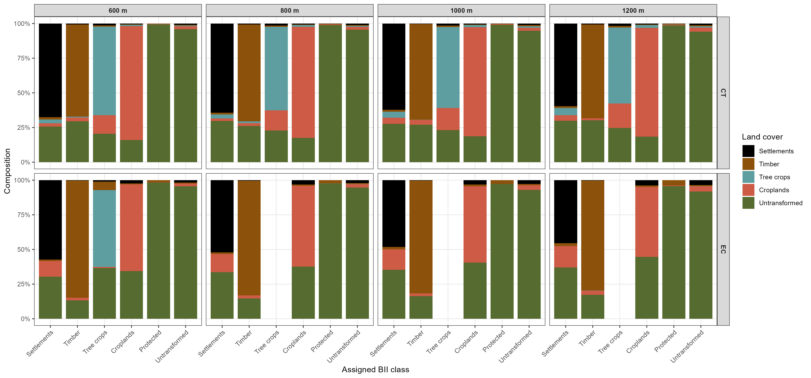
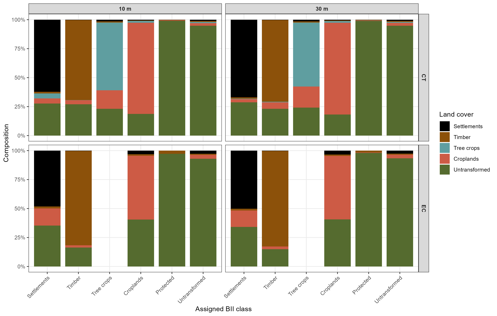
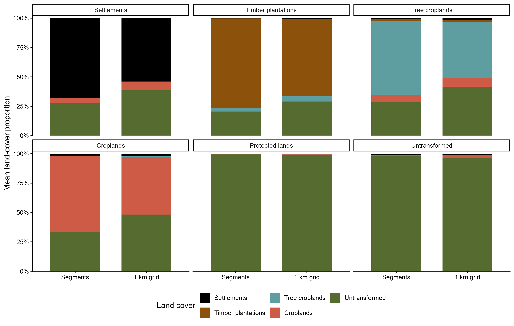
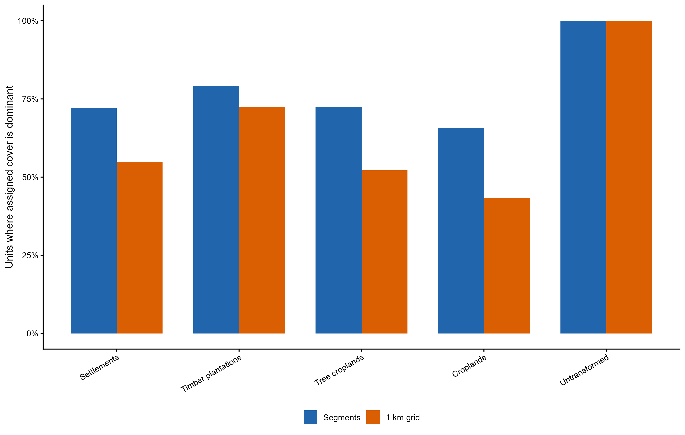

The page documents the technical decisions made during the segmentation process.

## Rationale and objective

The South African Biodiversity Intactness Index (BII) requires a consistent **spatial unit of assessment** to which a broad land-use class, land-use intensity, and eventually species information can be linked. Here, that unit is an image-derived *segment*: a group of neighbouring 10 m pixels with similar landscape characteristics.

A regular grid (also called a fishnet), that is typically used in broad scale spatial workflows, is straightforward to reproduce, but its boundaries are imposed without reference to the landscape. A grid cell can therefore split fields or plantations, or combine very different land uses, imposing artificial boundaries on the landscape. Segmentation can follow landscape variation more closely, potentially producing units that more closely align with underlying vegetation structure, land use patterns, and management units, which provides a more appropriate basis for assigning land use intensity and estimating biodiversity intactness.

Our aim in this part of the workflow is to select one nationally applicable segmentation configuration that balances land-cover homogeneity, recognisable landscape structure, consistency with the approximately 1 km analysis scale used in the regional BII, and a manageable number of units for national modelling. We tested various options for segmentation below.

## Data and segmentation methods

### Inputs and projection

We used the 2022 [Google Satellite Embedding V1](https://developers.google.com/earth-engine/datasets/catalog/GOOGLE_SATELLITE_EMBEDDING_V1_ANNUAL) collection (@brown). Each native 10 m pixel contained a 64-dimensional landscape representation. All 64 bands were supplied to [Simple Non-Iterative Clustering (SNIC)](https://developers.google.com/earth-engine/apidocs/ee-algorithms-image-segmentation-snic); i.e. they were not averaged across dimensions. SNIC formed connected objects from regularly spaced seeds according to feature similarity and spatial proximity.

Processing used SANBI's South African Albers Equal Area CRS (`AEA_RSA_WGS84`; WGS84 datum, central meridian 25° E, standard parallels 24° S and 33° S). The 10 m and 30 m grids shared a fixed origin and affine transforms of `[10, 0, 0, 0, -10, 0]` and `[30, 0, 0, 0, -30, 0]`, respectively. A fixed projection prevented GEE display scale from determining SNIC resolution.

The 2022 South African National Land Cover (SANLC) classification was used **to evaluate**, not generate, segments. Broad land-cover proportions were obtained from the BII crosswalk (`NLC_reclass_BII_land_use_intensity`), with protected-area overlap calculated separately. SANLC was assessed on the 10 m extraction grid during the sensitivity tests; its underlying land-cover information originated from the 20 m product.

### Sensitivity design

Two contrasting mixed-use rectangles were drawn in GEE: CT (Cape Town, including urban, industrial, tree croplands and mountain landscapes) and EC (Eastern Cape, including settlements, agriculture, plantations and natural vegetation). Each was buffered by 5 km during segmentation. Segments intersecting the test-area boundaries were excluded from comparisons.

We compared SNIC seed spacings of 600, 800, 1,000 and 1,200 m using 10 m embeddings. We then compared 10 m and 30 m embedding inputs at approximately 1,000 m seed spacing. For the 30 m scenario, each embedding band was spatially averaged from 10 m, and `size = 33` gave 990 m nominal spacing. Seed spacing controlled initial seed separation rather than final segment area.

`compactness = 1`, `connectivity = 8` and a 5 km buffer were held constant. The tests used `neighborhoodSize = 4 × size`; the subsequent national run used 66 pixels (`2 × 33`, the GEE default) to reduce processing demands. This change was not separately sensitivity-tested.

For each segment, we calculated the proportions of settlements, timber plantations, tree crops, croplands and untransformed land. The assigned BII class followed the first qualifying \>20% proportion in that order, followed by protected land (\>20% protected-area overlap), otherwise untransformed land. Protected land was an overlapping designation rather than a mutually exclusive cover type.

We assessed segment count, median area, area-weighted homogeneity (largest broad land-cover share), the proportion of assessed area in segments ≥80% homogeneous, and allocation retention (mapped area of a class occurring within segments assigned to that class). Composition figures represented pooled mapped hectares within each assigned class, not the mean segment. Repeated IDs in the test CSVs were combined using area-weighted proportions and boundary segments excluded; this procedure did not independently verify national ID uniqueness yet.

## Sensitivity results

### 1. Seed spacing

Increasing seed spacing reduced segment counts but increased land-cover mixing (Table 1). Moving from 800 to 1,000 m reduced segments by 36.9% in CT and 37.0% in EC, with homogeneity declining by only 1.1 and 2.1%, respectively. Median areas at 1,000 m were 91.0 ha (CT) and 89.8 ha (EC), close to the regional BII's 100 ha grid scale. We therefore selected approximately 1,000 m seed spacing.

Table 1. Segmentation metrics for four seed spacings. Counts and assessed areas excluded test-boundary segments. Homogeneity was the area-weighted dominant land-cover share; retention combined the four transformed covers. {#tbl-seed-spacing}

| Site | Seed (m) | Segments | Median (ha) | Assessed (ha) | Homogeneity (%) | ≥80% area (%) | Transformed retained (%) |
|:-----|---------:|---------:|------------:|--------------:|----------------:|--------------:|-------------------------:|
| CT   |      600 |    5,805 |        33.7 |       206,697 |            86.5 |          74.1 |                     92.2 |
| CT   |      800 |    3,209 |        58.4 |       202,547 |            84.6 |          69.1 |                     91.2 |
| CT   |    1,000 |    2,024 |        91.0 |       198,480 |            83.5 |          66.3 |                     90.0 |
| CT   |    1,200 |    1,396 |       128.4 |       193,667 |            82.4 |          64.8 |                     88.8 |
| EC   |      600 |    6,168 |        33.6 |       220,284 |            84.9 |          67.0 |                     88.5 |
| EC   |      800 |    3,409 |        57.8 |       215,810 |            82.5 |          61.5 |                     86.1 |
| EC   |    1,000 |    2,146 |        89.8 |       211,269 |            80.4 |          57.6 |                     83.7 |
| EC   |    1,200 |    1,463 |       127.1 |       207,434 |            78.6 |          51.4 |                     81.6 |

Table 2. Percentage of each mapped land-cover class retained in segments assigned to the same BII class. Protected land was excluded because it overlapped the land-cover categories.

| Site | Cover         | 600 m | 800 m | 1,000 m | 1,200 m |
|:-----|:--------------|------:|------:|--------:|--------:|
| CT   | Settlements   |  69.5 |  66.6 |    65.6 |    64.5 |
| CT   | Timber        |  74.2 |  69.9 |    68.6 |    66.7 |
| CT   | Tree crops    |  93.4 |  90.9 |    88.3 |    85.3 |
| CT   | Croplands     |  94.0 |  93.6 |    92.7 |    91.9 |
| CT   | Untransformed |  50.9 |  46.6 |    44.2 |    44.1 |
| EC   | Settlements   |  88.3 |  85.8 |    83.5 |    79.8 |
| EC   | Timber        |  96.2 |  95.5 |    94.1 |    94.0 |
| EC   | Tree crops    |  63.6 |   0.0 |     0.0 |     0.0 |
| EC   | Croplands     |  80.8 |  76.6 |    72.9 |    69.2 |
| EC   | Untransformed |  68.9 |  65.1 |    62.2 |    58.7 |

At coarser spacings, class retention generally declined. Tree crops were rare in EC, so their zero retention at 800–1,200 m was not considered representative of national performance. The pooled composition also showed substantial untransformed cover within assigned transformed classes, reflecting mixed land use and the 20% allocation threshold (@fig-seed-composition).

{#fig-seed-composition width="100%"}

### 2. Embedding resolution

At approximately 1,000 m spacing, moving from 10 m to 30 m reduced the SNIC input pixel count by 88.9% (ninefold fewer pixels). Mean homogeneity changed by −0.5 percentage points in CT and +0.2 in EC, with similarly small differences in transformed-cover retention (@tbl-resolution). The 30 m input therefore offered a substantial computational saving without materially reducing the evaluated land-cover homogeneity. Its seed spacing was 990 m, compared with 1,000 m for the 10 m input.

Table 3. Comparison of segmentation metrics for 10 m and spatially averaged 30 m embeddings at approximately 1 km seed spacing.

| Site | Input | Segments | Median (ha) | Assessed (ha) | Homogeneity (%) | ≥80% area (%) | Transformed retained (%) |
|:-----|:------|---------:|------------:|--------------:|----------------:|--------------:|-------------------------:|
| CT   | 10m   |    2,024 |        91.0 |       198,480 |            83.5 |          66.3 |                     90.0 |
| CT   | 30m   |    2,084 |        93.9 |       201,091 |            83.0 |          65.8 |                     89.3 |
| EC   | 10m   |    2,146 |        89.8 |       211,269 |            80.4 |          57.6 |                     83.7 |
| EC   | 30m   |    2,218 |        92.4 |       214,558 |            80.6 |          57.4 |                     84.2 |

Class-specific retention remained similar between resolutions (@tbl-resolution-retention), as did the pooled composition of the assigned BII classes (@fig-resolution-composition).

Table 4. Percentage of original mapped land cover retained within its assigned BII class, for the two embedding resolutions. {#tbl-resolution-retention}

| Site | Cover         | 10 m | 30 m |
|:-----|:--------------|-----:|-----:|
| CT   | Settlements   | 65.6 | 64.3 |
| CT   | Timber        | 68.6 | 65.6 |
| CT   | Tree crops    | 88.3 | 90.1 |
| CT   | Croplands     | 92.7 | 91.5 |
| CT   | Untransformed | 44.2 | 45.8 |
| EC   | Settlements   | 83.5 | 83.3 |
| EC   | Timber        | 94.1 | 94.4 |
| EC   | Tree crops    |  0.0 |  0.0 |
| EC   | Croplands     | 72.9 | 74.3 |
| EC   | Untransformed | 62.2 | 63.1 |

{#fig-resolution-composition width="100%"}

## National segmentation

We selected 2022 embeddings, all 64 dimensions, spatially averaged to 30 m, and ran SNIC with `size = 33` (990 m), `compactness = 1`, 8-connectivity and `neighborhoodSize = 66`. The national run used a 5 km buffer around the South African country boundary and exported the original SNIC `clusters` labels as a single-band Int64 raster, aligned to the 30 m Albers grid. The country boundary in the GEE data catalogue was use.

Before using the segments in species-level spatial joins, the raster was to be checked for coverage and duplicate IDs among disconnected objects, then vectorised and assigned stable geometries. Land-use classes and intensity would subsequently be linked to the validated segment IDs.

## Exploratory comparison with a regular grid

In an earlier northern Limpopo case study, image-derived segments were compared with regular 1 × 1 km cells using broad land-cover proportions and the same BII assignment rules. Segments more often contained a higher proportion of their assigned cover, and their assigned class more often matched the dominant cover, particularly for transformed land uses. This was an exploratory comparison, separate from the CT/EC parameter selection, and did not measure classification accuracy. We further explored what typically co-occurs with each broad land use class within each segments (Fig. 3).

{#fig-grid-composition width="100%"}

{#fig-grid-dominance width="100%"}
