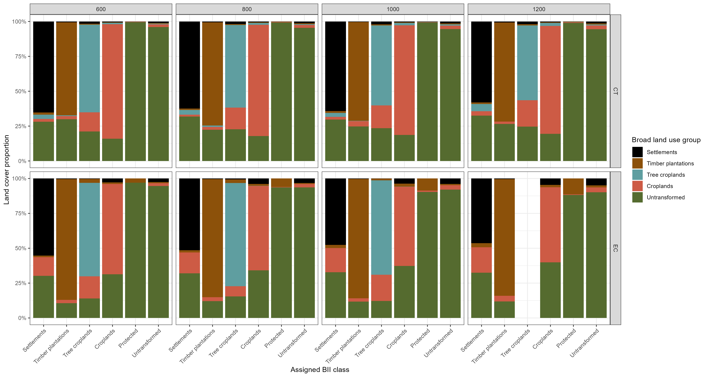
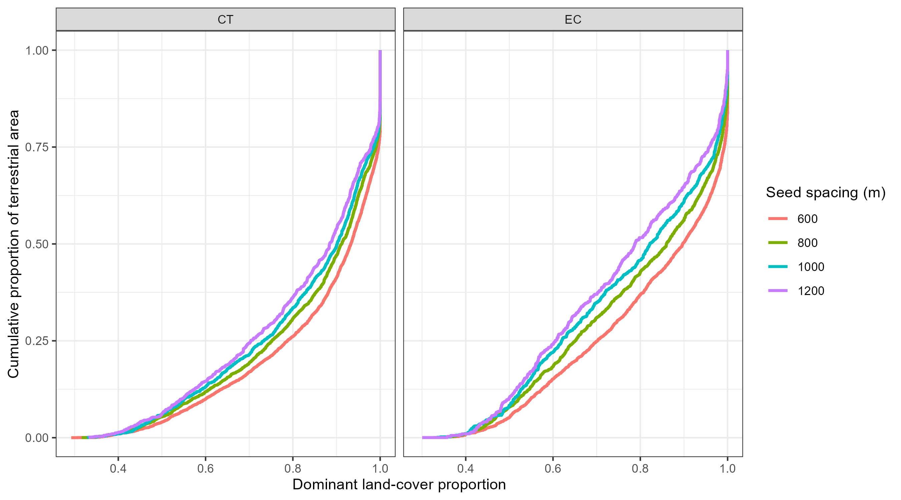
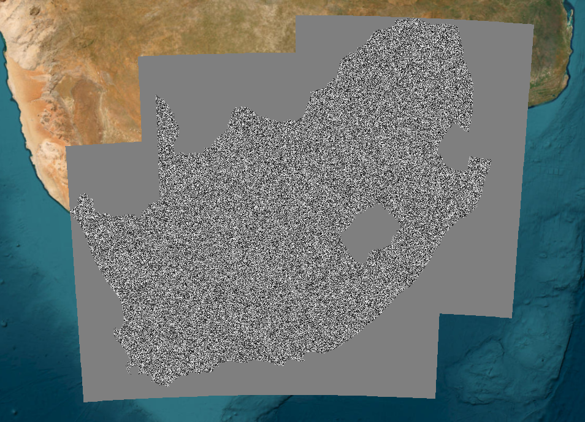

The page documents the technical decisions made during the segmentation process.

## Rationale and objective

The South African Biodiversity Intactness Index (BII) requires a consistent **spatial unit of assessment** to which a broad land-use class, land-use intensity, and eventually species information can be linked. Here, that unit is an image-derived *segment*: a group of neighbouring 10 m pixels with similar landscape characteristics.

A regular grid (also called a fishnet), that is typically used in broad scale spatial workflows, is straightforward to reproduce, but its boundaries are imposed without reference to the landscape. A grid cell can therefore split fields or plantations, or combine very different land uses, imposing artificial boundaries on the landscape. Segmentation can follow landscape variation more closely, potentially producing units that more closely align with underlying vegetation structure, land use patterns, and management units, which provides a more appropriate basis for assigning land use intensity and estimating biodiversity intactness.

Our aim in this part of the workflow is to select one nationally applicable segmentation configuration that balances land-cover homogeneity, recognisable landscape structure, consistency with the approximately 1 km analysis scale used in the regional BII, and a manageable number of units for national modelling. We tested various options for segmentation below.

## Input data

**Satellite representation.** Segmentation uses the 2022 annual [Google Satellite Embedding V1](https://developers.google.com/earth-engine/datasets/catalog/GOOGLE_SATELLITE_EMBEDDING_V1_ANNUAL) image collection (AlphaEarth Foundations; @brown). This dataset provides a 64-dimensional vector, or *landscape fingerprint*, for each 10 m pixel, combining patterns learned from multiple Earth-observation sources. The dimensions are not separate land-cover categories or individually interpreted physical measurements. SNIC used all 64 bands simultaneously to group pixels with similar signatures.

The exact Google Earth Engine (GEE) input is:

``` javascript
var embeddings = ee.ImageCollection(
  'GOOGLE/SATELLITE_EMBEDDING/V1/ANNUAL'
).filterDate('2022-01-01', '2023-01-01');
```

For each test region, the collection is filtered to the region (drawn in GEE), mosaicked and clipped to a 5 km buffer. The comparison runs SNIC on this **embedding mosaic**, not on the classified SANLC raster: the latter is retained as independent *composition data* for evaluating the resulting segments. No separate land/water mask is applied in the test-segmentation export script. Terrestrial masks is applied when calculating land-cover proportions in the next processing stage.

**Composition data for subsequent evaluation.** We will intersect each segment with (1) the broad BII land-use classification derived from 2022 SANLC, and (2) the original detailed SANLC subclasses. The intended GEE sources are:

``` text
projects/thicket-ecological-condition/assets/BII_SA/NLC_reclass_BII_land_use_intensity
projects/thicket-ecological-condition/assets/SA_NLC_2022_GEO
```

The reclassified layer provides the broad BII classes; the detailed SANLC layer allows homogeneity to be assessed within those classes. Protected-area cover will be assessed separately, because it is a management overlay that may overlap other land covers. **The exact bands, masks and crosswalk versions are recorded in the separate pages under Land Use Intensity and Segment Allocation.**

## Projection and analysis grid

The processing grid is held fixed for all scenarios. A **projected coordinate reference system** converts locations on the curved Earth into planar coordinates that can be expressed in metres. Without a fixed projection and pixel grid, the size of an SNIC seed measured in pixels could correspond to different ground distances, and the calculated segmentation could change with the resolution requested by GEE's map display.

We use SANBI's South African Albers Equal Area projection, `AEA_RSA_WGS84`, with the following parameters:

| Property                         | Value                            |
|----------------------------------|----------------------------------|
| Projection                       | Albers Equal Area (custom WGS84) |
| Datum / ellipsoid                | WGS84                            |
| Central meridian                 | 25° E                            |
| Latitude of origin               | 0°                               |
| Standard parallel 1              | 24° S (`-24`)                    |
| Standard parallel 2              | 33° S (`-33`)                    |
| False easting and false northing | 0 m, 0 m                         |
| Map units                        | metres                           |
| Pixel size                       | 10 × 10 m                        |
| Affine transform                 | `[10, 0, 0, 0, -10, 0]`          |

The two standard parallels are latitudes where this projection's area-preserving transformation is anchored. The **equal-area** property is useful for calculating and comparing land-use areas and proportions throughout South Africa. The specific affine transform additionally fixes the origin and orientation of the 10 m pixel grid, so tests do not shift relative to one another.

The GEE code uses a **custom WKT CRS definition**, not a generic Web Mercator or geographic latitude/longitude CRS. The exact WKT used in the test is preserved in the reproducible code below. The grid is explicitly assigned to the embedding mosaic using `setDefaultProjection(proj)`; the SNIC result is then forced onto the same grid using `.reproject({crs: proj})`. Lastly, every export specifies the same `crs` and `crsTransform`.

This matters because [GEE documents that SNIC can produce different results at different interactive map zoom levels](https://developers.google.com/earth-engine/apidocs/ee-algorithms-image-segmentation-snic). Forcing a 10 m processing projection prevents the viewer's zoom level from determining the algorithm's working resolution. As `reproject()` can be computationally expensive, it is applied only to the bounded test areas; results were exported as assets before downstream processing. The final selected segment size was then run nationally and used as the fixed segmentation layer for later stages.

## Algorithm and parameters

We use [Simple Non-Iterative Clustering (SNIC)](https://developers.google.com/earth-engine/apidocs/ee-algorithms-image-segmentation-snic), an object-based segmentation algorithm that starts from seed locations and grows connected clusters of spectrally/embedding-similar pixels. SNIC returns a raster in which pixels belonging to a cluster share an integer ID.

| Parameter             | Current value                                  | Reasoning                                                                                                                                               |
|------------------------|------------------------|------------------------|
| Input                 | 2022 annual Satellite Embeddings, all 64 bands | Captures multiple landscape characteristics in a consistent national dataset rather than relying on one spectral band.                                  |
| Processing CRS        | `AEA_RSA_WGS84`                                | Metre-based, equal-area reference appropriate for South African area calculations.                                                                      |
| Processing pixel size | 10 m                                           | Matches the nominal resolution of the embedding data and fixes the interpretation of pixel-based settings.                                              |
| `size`                | **60, 80, 100, 120 pixels**                    | Four seed spacings centred around the approximately 1 km landscape scale of the regional BII. This is the **only intentionally varied SNIC parameter**. |
| `compactness`         | `1`                                            | Balances similarity of the embedding signatures and spatial compactness of the segments.                                                                |
| `connectivity`        | `8`                                            | Allows side-adjacent and diagonally adjacent pixels to be grouped.                                                                                      |
| `neighborhoodSize`    | `size * 4`                                     | Provides a processing neighbourhood larger than the seed spacing to reduce tile-edge artefacts; scaled consistently in all test scenarios.              |
| `seeds`               | Not supplied                                   | SNIC generates its default regularly spaced seed grid; no random seed locations are specified.                                                          |
| Region buffer         | 5,000 m                                        | Reduces the risk that artificial clipping boundaries influence segments within the test rectangle.                                                      |
| Export ID band        | `clusters` → `unit_id`                         | Stores the calculated cluster identifier as an integer raster.                                                                                          |
| Asset pyramiding      | `mode`                                         | Preserves categorical IDs when assets are viewed at coarser display resolutions.                                                                        |

**Important:** `size` specifies *initial seed spacing in pixels*, **not the final segment diameter or area**. Actual segment sizes and shapes depend on the embedding patterns and growth of clusters. The nominal meter values are useful scenario labels, but actual segment areas will be measured and reported.

### Why four sizes?

| Scenario name | `size` in 10 m pixels | Nominal seed spacing | Regular-square area for scale comparison only |
|------------------|-----------------:|-----------------:|-----------------:|
| 600 m         |                    60 |                600 m |                                         36 ha |
| 800 m         |                    80 |                800 m |                                         64 ha |
| 1,000 m       |                   100 |              1,000 m |                                        100 ha |
| 1,200 m       |                   120 |              1,200 m |                                        144 ha |

Preliminary exploration showed that connectivity of 8 and compactness settlings of 1 followed natural shapes in the landscape. We thus generated 4 segment "scenarios" with the same parameters settings, only varying size. This isolates the effect of the size parameter more cleanly and makes the eventual national product reproducible.

-   **600 m** tests whether finer units capture settlement edges, agricultural fields and small, contrasting land-cover patches sufficiently better to justify the extra segment count.
-   **800 m** was included as a candidate segment scale to assess whether it provides an appropriate balance between spatial detail and landscape-scale representation.
-   **1,000 m** approximates the linear scale of the original regional BII's 1 × 1 km mapping grid, while allowing SNIC boundaries to follow spatial patterns rather than fixed squares.
-   **1,200 m** tests whether a somewhat coarser representation reduces processing demands without merging ecologically different land uses excessively.

A 1,000 m **SNIC seed spacing is not the same as a fixed 1 × 1 km grid**. A grid can be retained as an additional reference comparison, but it is not one of the four SNIC sensitivity scenarios.

Earlier exploratory segmentation at other scales suggested that small segments could follow very fine land-cover variation while losing the broader landscape context. Those trials motivated the provisional 800 m layer but were not a controlled four-size comparison. The sensitivity test documented here is intended to provide the quantitative justification for a final choice, rather than assume the earlier choice was optimal.

## Selection of two test landscapes

We use two heterogeneous mixed-use landscapes, rather than comparing segment sizes only in predominantly natural terrain. Both were chosen because they contain land uses that are easy to combine unintentionally within a large assessment unit, but their spatial configurations differ substantially.

| Test site                         | GEE geometry name | Landscape composition and motivation                                                                                                                                                                                                                               |
|------------------------|------------------------|------------------------|
| Cape Town / surrounding landscape | `CT`              | A well-known mosaic of urban and industrial areas, timber plantations, mountainous natural vegetation, and smallholdings. It tests segmentation at sharp land-use boundaries, along natural–built-up interfaces, and in terrain with strong topographic variation. |
| Eastern Cape mixed landscape      | `EC`              | A fine-grained mosaic of villages, croplands and natural vegetation. It tests whether small, interspersed land uses are separated adequately without creating an excessive number of small fragments.                                                              |

Testing these contrasting landscapes makes the sensitivity analysis more informative than using only one urban or rural landscape. The samples are purposeful test sites, not statistically representative samples of South Africa; conclusions should be framed as evidence of the method's behaviour in two challenging land-use mosaics.

The rectangles are drawn in the GEE Code Editor and named `CT` and `EC`. Each rectangle is buffered by 5 km for segmentation; the central, unbuffered rectangle is the evaluation area. In particular, segments intersecting the central rectangle boundary will be flagged and can be excluded from summaries that require complete segments. The wider buffered assets can still be displayed for a map figure.

## Export workflow

The export step creates eight 10 m integer `unit_id` rasters: the four seed spacings for each of the two sites. All are saved as separate GEE assets.

Asset root:

``` text
projects/thicket-ecological-condition/assets/BII_SA/
```

Asset naming:

| Site | 600 m                        | 800 m                        | 1,000 m                       | 1,200 m                       |
|---------------|---------------|---------------|---------------|---------------|
| CT   | `Segments_600m_CT_AEA10m_v1` | `Segments_800m_CT_AEA10m_v1` | `Segments_1000m_CT_AEA10m_v1` | `Segments_1200m_CT_AEA10m_v1` |
| EC   | `Segments_600m_EC_AEA10m_v1` | `Segments_800m_EC_AEA10m_v1` | `Segments_1000m_EC_AEA10m_v1` | `Segments_1200m_EC_AEA10m_v1` |

The test assets are saved once and then called as inputs to the subsequent composition calculations. This separates expensive segmentation from lighter repeated analyses and ensures that all statistics and map figures refer to the same pixel-to-segment allocation.

### Exact GEE export script

The following is the agreed 2026-10-17 sensitivity-test script. **Prerequisite:** draw or import the two geometries as `CT` and `EC` (and preserve their coordinates for final reproduction).

``` javascript
// BII segmentation sensitivity: CT + EC; 600/800/1000/1200 m
var root = 'projects/thicket-ecological-condition/assets/BII_SA/';

var crs =
  'PROJCS["AEA_RSA_WGS84",' +
  'GEOGCS["GCS_WGS_1984",DATUM["D_WGS_1984",' +
  'SPHEROID["WGS_1984",6378137,298.257223563]],' +
  'PRIMEM["Greenwich",0],UNIT["Degree",0.0174532925199433]],' +
  'PROJECTION["Albers"],' +
  'PARAMETER["false_easting",0],' +
  'PARAMETER["false_northing",0],' +
  'PARAMETER["central_meridian",25],' +
  'PARAMETER["standard_parallel_1",-24],' +
  'PARAMETER["standard_parallel_2",-33],' +
  'PARAMETER["latitude_of_origin",0],UNIT["Meter",1]]';

var transform = [10, 0, 0, 0, -10, 0];
var proj = ee.Projection(crs, transform);

var embeddings = ee.ImageCollection(
  'GOOGLE/SATELLITE_EMBEDDING/V1/ANNUAL'
).filterDate('2022-01-01', '2023-01-01');

function exportSegments(region, name) {
  var aoi = region.buffer(5000);
  var input = embeddings.filterBounds(aoi).mosaic()
    .clip(aoi).setDefaultProjection(proj);

  [60, 80, 100, 120].forEach(function(size) {
    var metres = size * 10;
    var id = 'Segments_' + metres + 'm_' + name + '_AEA10m_v1';

    var clusters = ee.Algorithms.Image.Segmentation.SNIC({
      image: input,
      size: size,
      compactness: 1,
      connectivity: 8,
      neighborhoodSize: size * 4
    }).select('clusters')
      .reproject({crs: proj})
      .rename('unit_id').toInt64();

    Export.image.toAsset({
      image: clusters,
      description: id,
      assetId: root + id,
      region: aoi,
      crs: crs,
      crsTransform: transform,
      pyramidingPolicy: {'.default': 'mode'},
      maxPixels: 1e10
    });
  });
}

exportSegments(CT, 'CT');
exportSegments(EC, 'EC');

// Record rectangle coordinates alongside the script.
print('CT rectangle vertices:', CT.coordinates());
print('EC rectangle vertices:', EC.coordinates());
```

Only the `size` argument changes between scenarios. No random seed image is supplied. The exported assets should be inspected for successful completion, valid 10 m projection metadata, coverage and integer IDs before they are used in any composition analysis.

## Sensitivity analysis and validation plan

The goal of this evaluation is not to validate the broad land use group calculation. It tests whether the *spatial units* retain meaningful land-use composition, which is the intended input to the BII.

For each of the eight segment assets, we calculated the area and proportion of every mapped broad BII land-use class and, separately, every detailed SANLC subclass within each segment. Pixel areas were summed using `ee.Image.pixelArea()` and divided by the mapped terrestrial area of the segment. The protected-area proportion was extracted as a separate overlapping attribute, not added to land-cover proportions.

A segment-level CSV export contained:

| Field                                                               | Meaning                                                                                                            |
|------------------------------------|------------------------------------|
| `site`, `scenario`, `unit_id`                                       | Test landscape, nominal seed spacing and segment identifier; IDs are only compared *within* a given site/scenario. |
| `area_ha`                                                           | Terrestrial mapped area in hectares.                                                                               |
| `p_settlement`, `p_timber`, `p_treecrop`, `p_cropland`, `p_untrans` | Proportion of terrestrial area occupied by each mapped broad BII land-use class.                                   |
| `p_protected`                                                       | Protected-area overlap (not part of the land-cover proportions sum).                                               |
| `assigned_class`                                                    | Broad class under the agreed \>20% sequential allocation rule.                                                     |
| `boundary`                                                          | Flag identifying segments that intersect the core test-rectangle boundary.                                         |

A second long-format subclass CSV (`site`, `scenario`, `unit_id`, `sanlc_class`, `area_ha`, `proportion`) retained the full SANLC composition for detailed checks in R. Raster-to-vector conversion of the buffered test IDs (for example to GeoJSON) will supply segment outlines for GIS map figures. The CSV is the analysis output; vectorisation is primarily for cartographic comparison.

We will calculate and compare:

1.  **Broad-class homogeneity:** the largest land-use proportion in each segment (a value of 1 indicates only one broad class).
2.  **Detailed-class homogeneity:** the largest original SANLC subclass proportion, distinguishing variation hidden within a broad class.
3.  **Mixed-segment frequency:** the proportion of segments containing substantial amounts of more than one broad class.
4.  **Allocation:** for each broad class, the proportion of its mapped area that occurs in segments ultimately assigned to the same class under the 20% decision tree.
5.  **Segment-area distribution and counts:** the real distribution of segment size and the computational consequences of a finer or coarser assessment unit.

Summaries were calculated both **by segment** and **area-weighted**, separately for CT and EC and where relevant by land-use class. These complementary summaries are important: a large number of small fragments should not overwhelm the total mapped landscape, while a few very large natural segments should not conceal poor representation of settlements or croplands.

Planned figures include (a) four identical-scale maps of segment boundaries over the same basemap per study area, (b) homogeneity distributions by scenario, and (c) differences in composition/allocation fidelity by land use. The regular 1 × 1 km grid may be retained as a contextual reference from earlier analyses, but it will not be conflated with the 1,000 m SNIC scenario.

### Criteria for deciding the national size

The preferred scenario should show a reasonable balance between higher within-segment homogeneity, preserving small transformed land-use mosaics, recognisable landscape boundaries and national processing feasibility. If the 600 m results provide only limited improvement over 800 m while substantially increasing segment counts, 800 m would remain a reasonable compromise. If results contradict that expectation, the final choice should reflect the evidence. We will report the observed trade-offs and record the final selected size after analysis, rather than present a preferred size as an already validated result.

### Results

Land-cover homogeneity declined progressively with increasing SNIC seed spacing across both study areas (Table @tbl-segmentation-comparison). The 600 m scenario produced the highest homogeneity but substantially more assessment units, while the 1,200 m scenario showed greater mixing of land-cover classes and reduced retention of transformed land uses. The 800 m and 1,000 m scenarios were therefore considered the most suitable compromises between spatial detail and computational efficiency.

Increasing seed spacing from 800 to 1,000 m reduced the number of segments by 36.9% in CT and 37.6% in EC, with only modest reductions in mean land-cover homogeneity (1.1 and 1.9%, respectively). The proportion of terrestrial area within segments containing at least 80% of a single land-cover class declined by approximately 3 percentage points in both areas. Class-specific allocation also remained broadly comparable, with some reduction in the retention of transformed land uses at larger segment sizes. A 1,000 m seed spacing was therefore selected, providing substantially fewer assessment units with relatively little loss of land-cover homogeneity. The resulting median segment areas (90.2 ha in CT and 88.8 ha in EC) were also broadly comparable to the 100 ha grid cells used in the original sub-Saharan African BII assessment, while retaining the advantage of image-derived segment boundaries. The **1000m segment size is the most practical compromise between land-cover homogeneity, ecological representation and computation efficiency among the tested scenarios.**

{width="665"}

Table 2. Comparison of segmentation characteristics across four SNIC seed spacings in Cape Town (CT) and the Eastern Cape (EC). Mean homogeneity represents the area-weighted mean proportion of each segment occupied by its dominant broad BII land-cover class. The final column gives the percentage of assessed terrestrial area occurring in segments with at least 80% homogeneous land cover. Segment counts and areas exclude boundary segments and combine repeated segment IDs assumed to represent fragmented segments. {#tbl-segmentation-comparison}

| Study area | Seed spacing (m) | Number of segments | Median segment area (ha) | Mean homogeneity (%) | Area ≥80% homogeneous (%) |
|------------|-----------:|-----------:|-----------:|-----------:|-----------:|
| CT         |              600 |              5,807 |                     33.9 |                 86.6 |                      73.9 |
| CT         |              800 |              3,201 |                     58.2 |                 84.8 |                      69.3 |
| CT         |        **1,000** |          **2,020** |                 **90.2** |             **83.7** |                  **66.5** |
| CT         |            1,200 |              1,377 |                    131.2 |                 82.5 |                      63.8 |
| EC         |              600 |              3,233 |                     33.3 |                 83.2 |                      63.1 |
| EC         |              800 |              1,784 |                     56.8 |                 80.5 |                      57.3 |
| EC         |        **1,000** |          **1,114** |                 **88.8** |             **78.6** |                  **54.2** |
| EC         |            1,200 |                756 |                    123.3 |                 76.9 |                      48.4 |

{width="688"}

## National production and version control

The national layer was generated with the selected size, fixed 10 m Albers settings. The test-area IDs are not presumed to match the eventual national IDs because processing extent and tiling can affect cluster numbering and potentially boundaries.

Before transferring a national segmentation layer to the collaborator who links species information to the segments, we will "froze" the final raster, checked its coverage and unique IDs, preserved its original 10 m grid and CRS, and recorded the exact asset path and generation code. Land-use assignment and intensity can subsequently be updated as attributes without altering the frozen segment geometry or IDs.

## 


